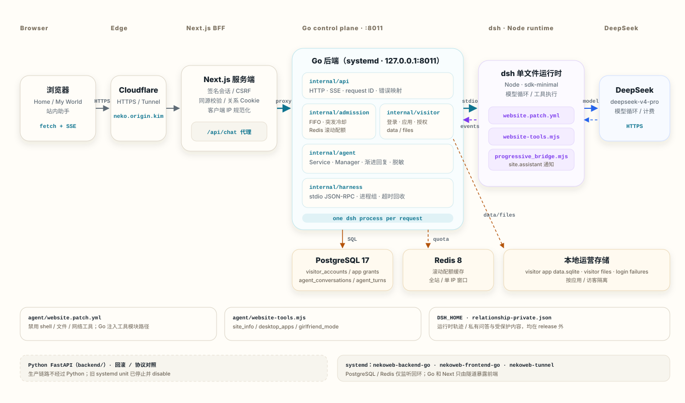
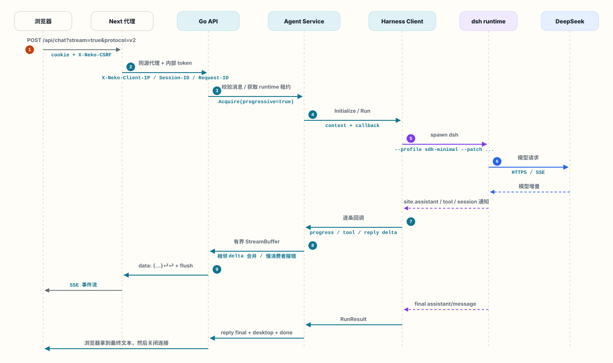

# Nekovccat · My World
https://neko.origin.kim/
Next.js + Go 控制面的个人网站（Python FastAPI 保留为回滚路径）。Home 的右下角提供 **NEKO 站内助手**；About 与 Contact 合并进 My World 的 **NEKO Browser**。`/my-world` 是一台可交互的像素风复古电脑，内置 DeepSeek Harness 站内 Agent、音乐软件、站点导航、便签与外观设置。

## 全站助手

点击 Home 右下角的 **NEKO 站内助手**，默认打开 **Agent 助手** 标签；第二个 **音乐** 标签和入口旁的磁带按钮可进入 NEKO Music。Home 使用深色玻璃面板；My World 保留各自独立的复古桌面软件窗口。

全站入口与桌面 Agent 共用当前会话、输入草稿和正在进行的请求。通过站内链接切换页面、切换助手标签或收起面板后，再打开即可继续。聊天历史保存在当前浏览器；草稿和进行中的请求属于当前网页会话，刷新或退出页面不会在后台继续请求，也不提供跨设备同步。

## 桌面软件

- **Neko Agent**：官方 DeepSeek Harness 负责模型循环、会话轨迹与站内工具，默认使用 DeepSeek V4 Pro。
- **NEKO Browser**：复古站内浏览器，包含关于 NEKO、项目与经历、42 张 Minecraft 建筑图片及联系栏目；旧 About / Contact 地址自动跳转。公开身份只使用 NEKO，不公开原始简历或真实姓名。
- **赞助 NEKO**：展示 Ethereum 主网 ETH 收款二维码与地址，支持兼容浏览器钱包连接及用户确认后的原生 ETH 转账，不请求授权额度、助记词或私钥。交易回执未确认时不显示成功，也不自动重发。
- **NEKO Music**：粘贴网易云或 Spotify 分享链接，加载官方播放器，保存常听收藏。
- **Notes**：在当前浏览器自动保存便签。
- **Settings**：切换壁纸与静态 CRT 扫描线。
- **About Computer**：查看桌面说明。

桌面支持打开、聚焦、拖动、方向键移动、最大化、最小化和关闭窗口，任务栏可恢复窗口。移动端使用单窗口布局，支持减少动态效果偏好。

### 伴侣模式彩蛋

NEKO 的欢迎语和首次网站介绍会直接告诉访客「这个网站还有彩蛋模式哦」。点击 Agent 内的「开启彩蛋模式」，或直接说「我想开启伴侣模式」，跟随它依次回答五个关于 NEKO 的问题：喜欢的动漫人物、生日、猫猫的名字、MBTI、喜欢的人的英文缩写。桌面不再显示额外的小世界提示。动漫人物答中配置的任意一个即可；生日支持常见日期格式，英文答案不区分大小写。答错可以重试，Agent 不会主动公布答案。工具会验证已提供的答案并返回下一题，五题全部通过且整轮请求成功后，浏览器才切换桌面；普通聊天、失败、取消或只有文字宣称成功的回复均不会触发。

五题通过后，后端签发绑定当前聊天会话的短时凭证，Next 校验后写入签名的 `HttpOnly` 授权 Cookie。彩蛋正文、日期、默认内容和专属壁纸保存在服务器私有目录，只通过需要授权 Cookie 的接口返回，不进入前端源码、静态包或公开 Git 仓库。修改 `localStorage`、伪造前端事件或直接访问资源地址不能获得内容。授权有效期为 30 天；访客自己的愿望清单仍只保存在当前浏览器，Agent 无权读取。

### NEKO Music 音乐软件

从全站助手的 **音乐** 标签、入口旁的磁带按钮，或 My World 桌面和开始菜单中的 **NEKO Music** 打开音乐软件。粘贴平台分享链接并点击“加载”，再使用官方播放器里的播放按钮。网易云支持歌曲和歌单；Spotify 支持歌曲、专辑、歌单、音乐人和播客。输入链接会自动识别平台，分享文案里的完整链接也可使用。短链接（`163cn.tv`、`spotify.link`）请先在原平台打开，再复制完整地址。

可以给收藏命名，最多保存 20 个。收藏仅保存在当前浏览器，各页面共用同一份收藏，刷新或关闭音乐窗口后仍可恢复。

音乐会话和唯一的官方 iframe 由根布局持有。通过站内链接切换 Home、About、My World 和 Contact，收起助手面板、切回 Agent 标签或最小化桌面音乐窗口，都保留当前播放器。选择网易云或 Spotify 平台按钮只切换链接输入入口；加载另一首音乐时才替换当前播放器。点击“停止播放”、入口旁的停止按钮，或关闭 My World 的 NEKO Music 窗口会停止播放；刷新网页、关闭浏览器标签页或退出网站也会结束当前播放。

集成使用平台官方 iframe，不需要额外 API 密钥。提供网易云与 Spotify 官方登录入口，登录发生在官方页面；当前没有音乐账户绑定或个人歌单同步，内嵌播放器也不保证继承会员状态；播放范围与预览时长由平台的版权、地区、登录状态及浏览器支持决定。若播放器空白或不能播放，使用“在原平台打开”。应用不下载或代理音频，也不读取平台登录凭据。NEKO Agent 可介绍音乐软件，但不能控制播放器或读取本地收藏。

## 本地启动

### 加载与交互

首页的文字与轻量风景预览直接呈现。预览解码、字体与首屏绘制完成后，桌面端利用空闲时间加载 Three.js；完整纹理解码好后才创建 WebGL 画布。手机和低功耗设备先展示静态风景，触摸背景时才请求较小的互动纹理；减少动态效果、省流量或 2G 连接不通过这类隐式手势加载全景，键盘聚焦仍可找到主动开启入口。暂停旋转后按需绘制，标签页隐藏时停止绘制，离页取消未完成下载并释放纹理，加载失败保留预览并提供重试。全景资源可通过 `node scripts/prepare-panorama.mjs` 从保留的原图重新生成，资源清单和带内容哈希的文件名会同步更新。

Agent 使用 `protocol=v2` 接收真实正文增量，按动画帧批量显示，完成时以最终答案校准；没有将整段回复延迟播放。每条回复内可展开真实处理状态与工具进度，用户向上翻看时停止自动跟随。原始推理内容、工具参数和工具返回不会显示为处理过程。已打开的旧页面继续使用原 SSE 协议。

桌面软件和首页助手内容按需加载。聊天支持停止回复、保留草稿和重试上一条；Esc 收起首页助手并保留输入，停止不撤销服务器已经完成的授权。窗口拖动按动画帧更新位置，打开、收起和关闭都有键盘焦点接续。建筑相册支持连续切图、左右方向键和 Esc 收起，并恢复缩略图位置。音乐显示官方页面的加载状态，加载较慢时提供重新加载入口；页面已载入不代表平台一定允许播放。

生产脚本体积可用 `python3 scripts/measure-bundle.py frontend/.next` 检查。输出是生产 HTML 直接引用的 JavaScript 原始体积和本地 gzip 体积，排除后续按需加载内容，不代替浏览器网络统计或 Web Vitals。

当前工作区已经安装依赖并配置好本地密钥。在项目根目录运行：

```bash
backend/.venv/bin/python scripts/dev.py start
backend/.venv/bin/python scripts/dev.py status
backend/.venv/bin/python scripts/dev.py stop
```

| 服务 | 本地地址 |
| --- | --- |
| My World 桌面 | http://127.0.0.1:3010/my-world |
| 网站首页 | http://127.0.0.1:3010 |
| 后端 API 文档 | http://127.0.0.1:8010/docs |

前后端绑定回环地址。Harness SDK 在后端按请求管理本地运行时子进程，不需要额外网关端口。启动脚本保留本项目已有进程，端口被其他进程占用时停止并提示。日志和 PID 位于 `work/nekovccat-*.log` / `work/nekovccat-*.pid`。修改后端或模型配置后，停止并重新启动。

生产使用 Go 控制面（8011）；上面的 `scripts/dev.py` 保留的是 Python 回滚路径。Go 的本地启动、测试和访客后端说明见 [`backend-go/README.md`](backend-go/README.md)。

### 首次安装到新环境

需要 Node.js 20.9+、Python 3.11+；官方 SDK 会安装同版本、与平台匹配的原生运行时 wheel。

```bash
python3.12 -m venv backend/.venv
backend/.venv/bin/python -m pip install -r backend/requirements.txt
(cd frontend && npm ci)
cp backend/.env.example backend/.env
```

在本机编辑 `backend/.env`，填写自己的 DeepSeek 密钥。不要把密钥提交到 Git，也不要写入 `NEXT_PUBLIC_*` 变量。

```dotenv
DEEPSEEK_API_KEY=replace_locally
DEEPSEEK_BASE_URL=https://api.deepseek.com
DEEPSEEK_MODEL=deepseek-v4-pro
DEEPSEEK_REASONING_EFFORT=low
DATABASE_ENABLED=false
```

无需 PostgreSQL 即可使用当前桌面与聊天功能。现有数据库相关代码保留为可选功能；`docker-compose.yml` 尚未更新至此次 Harness 架构，当前完整启动入口为上面的本地脚本。

## DeepSeek Harness 架构

独立生产入口为 `https://neko.origin.kim`，通过专属 Cloudflare Managed Tunnel 访问服务器上的新站服务，保留原 `origin.kim` 和已有项目。服务模板、构建步骤、公网验收和回滚方法见 [deployment/README.md](deployment/README.md)。生产聊天默认使用同源 `/api/chat`；后端地址只通过 Next 服务端的 `PYTHON_API_URL` 设置。请勿将本机 `.env.local`、虚拟环境或运行轨迹包含在发布包中。

```text
全站助手 / 像素桌面的 Neko Agent 窗口
  → 根布局共享 Agent 会话、草稿与进行中的请求
  → Next.js /api/chat（同源代理）
  → Go /api/chat/（准入、校验、SSE、取消与进程回收）
  → Go stdio JSON-RPC 客户端
  → 官方 dsh 原生运行时 / Cordis 插件系统
  → DeepSeek V4 Pro（模型循环）
  ↔ site_info / desktop_apps / girlfriend_mode（受限站内工具插件）
```

使用官方 `sdk-minimal` profile 并通过 `agent/website.patch.yml` 定制组合，不修改 Harness 源码。站内插件 `agent/website-tools.mjs` 注册三个工具：

- `site_info`：查询站内公开栏目、描述、桌面深链接及助手入口。
- `desktop_apps`：查询桌面软件的用途和能力范围，以及 Agent、音乐在其它页面的使用方式。
- `girlfriend_mode`：在用户明确寻找伴侣模式彩蛋时，验证其提供的五道个人问答；全部通过后由后端发送受限桌面事件，浏览器再应用主题。答案配置只传给工具运行时，不进入模型工具描述。

此站点组合禁用默认 shell 工具及其执行基础设施，未加载文件编辑、浏览器、搜索等通用工具；插件还会阻止所有非站内工具执行。它不读取本机文件、便签或外部网站。About/Contact 的真实公开内容由 NEKO Browser 展示；Agent 使用整理后的公开资料，不读取原始简历，只称呼作者为 NEKO，不透露、确认或猜测真实姓名。

每个请求使用独立 SDK 运行时与随机会话 ID。浏览器的历史保留 `role/content`，作为结构化 `previous_context` 传入 SDK，当前问题独立放在 `input` 中。SDK 当前接收单次用户提示，未使用不存在的 OpenAI messages 导入接口。Harness 的 JSONL 轨迹位于 `work/deepseek-harness-home`；没有跨设备账户或聊天同步。

生产前后端只监听回环地址，经专属 Cloudflare Tunnel 进入。聊天使用签名 HttpOnly 会话、CSRF 与固定来源校验，前后端用内部令牌鉴权；限制请求体、消息长度、可用参数和并发，SQLite 持久化每 IP 与全站额度。只信任由 Cloudflare 注入的客户端地址；匿名会话不是用户身份认证，仍需关注额度消耗。模型密钥仅由服务端传入运行时环境；配置模板不含密钥。请求取消、客户端断开、超时后会关闭对应运行时子进程。浏览器接收站内工具执行状态及文本事件；中文 UTF-8、SSE 跨分包、断流与 RESET 的旧请求写入均有回归验证。

Agent 入口在读取请求体前拦截连续刷请求，聊天与会话接口分别限制突发访问。正常访客在 3 个执行名额占满时进入最多 12 位、最长 8 秒的 FIFO 队列，同一来源只能有一个执行中或等待中的请求；排队取消、超时和拒绝不消耗聊天额度。每个 IPv4 或 IPv6 /64 默认共享 6 次/分钟、30 次/小时、60 次/滚动 24 小时的执行额度，全站仍保留 400 次/滚动 24 小时上限。请求真正获准执行后才计次，已开始的模型请求取消或失败仍计次。限流返回可读的等待时间，客户端不自动重试。部署与边缘防护边界见 [Agent 流量保护](deployment/agent-protection.md)。

当前官方 Python SDK 0.1.5rc1 未对外转发逐 token 通知，因此工具状态实时更新，回答生成完毕后整段显示；页面没有人工模拟打字效果。

生产当前使用 Go 控制面（`backend-go/`）：它负责准入、SSE、dsh 子进程和 Redis 滚动配额，用户与每轮 Agent 交互写入 PostgreSQL。Python FastAPI 版本保留为回滚和协议对照；下面关于 lifespan/SQLite 的说明仅适用于回滚路径。Go 服务每个请求独立准备 dsh runtime，写超时、取消或失败都会回收对应进程；`/health` 检查进程存活，`/api/ready` 检查 Agent 配置、代理认证、Redis 配额和 PostgreSQL 就绪状态，不调用付费模型。请求编号和各阶段耗时写入结构化日志，不写入用户正文或私人问答。

官方资料：[DeepSeek Harness](https://www.deepseek.com/harness/en/)、[源码与 Python SDK](https://github.com/deepseek-ai/deepseek-harness/tree/main/python/sdk)。本项目固定 `deepseek-harness-sdk==0.1.5rc1`，它仍是官方开发者预览版本。

## Go 后端（生产控制面）

生产已切换到 [`backend-go/`](backend-go/) 的 Go 控制面；Python FastAPI 后端保留为回滚和协议对照。Go 版本不重写 Agent，只替换 SDK 客户端和 HTTP/SSE 控制面。

### 改造目标与意义

这次改造的目标不是“用 Go 重写 Agent”，而是把后端拆成两个清晰边界：

- **Go 控制面**：对外 HTTP/JSON/SSE、消息校验、取消与超时、每请求 `dsh` 子进程、进程组回收、请求 ID、日志和 readiness。
- **官方 dsh 运行时**：模型循环、工具执行、session/tool 事件和 DeepSeek 调用，继续使用官方 Node 运行时与 `agent/` 下的 JS 资产。

引入 Go 的实际意义：

1. **进程生命周期更可控**：每个聊天请求对应一个独立 `dsh` 子进程。Go 的 `context`、goroutine、进程组和 `ResponseController` 让取消、超时、SSE 写失败和关闭顺序更容易写清楚，减少“浏览器断开了但模型进程还在跑”的风险。
2. **流式边界更明确**：Go 负责有界缓冲、相邻 delta 合并、慢消费者报错、心跳和逐次写超时；dsh 的真实通知只由一层投影逻辑消费，避免前端直接处理 Harness 内部协议。
3. **部署少一套 Python 运行时**：Go 服务是静态二进制，不需要 venv 和 pip 依赖。注意这不等于单语言：仍然需要官方 Node `dsh`、`agent/*.mjs` 和 Next.js 前端。
4. **类型与错误边界更硬**：stdin/stdout JSON-RPC、工具事件、SSE 事件、配置和 HTTP 错误都有显式结构；编译期能拦住一部分 Python 动态 dict 容易漏掉的问题。
5. **为后续扩展留出边界**：如果以后要做多实例、共享准入、独立网关或更严格的进程隔离，Go 控制面比在 FastAPI 里继续叠加异步/线程/子进程逻辑更容易演进。

它**不解决**这些问题：

- 不降低模型延迟，也不降低 DeepSeek token 成本
- 不把 267MB 的官方 `dsh` Node 运行时变成 Go
- 不共享突发冷却；多实例的 AttemptGuard 仍是进程内状态
- 不替代 Next.js 的会话、CSRF、关系内容 Cookie 和同源代理

### 替换了什么，没替换什么

| 层 | 当前 Go 原型 | 说明 |
| --- | --- | --- |
| HTTP API / SSE | Go | `/api/chat`、`/health`、`/api/ready`，保留 v1/v2 协议 |
| 请求校验 / 取消 / 超时 | Go | 严格 JSON、长度限制、context 传播 |
| dsh 进程管理 | Go | 每请求独立进程、shutdown、TERM 进程组、超时回收 |
| Harness stdio 协议 | Go 自研客户端 | 不依赖 Python SDK，需要跟随官方协议版本 |
| 模型循环 / 工具执行 | 官方 Node dsh | 不重写 `website-tools.mjs` 或 Cordis 组合 |
| 前端会话 / CSRF / 关系内容 | Next.js | 不改前端代码，只把代理指向 Go |
| Python FastAPI | 保留 | 作为对照、回滚和协议参考，不在 Go 链路中运行 |

### 从 MK 分支引入的后端功能

这次先把 MK 的后端能力接到 Go 服务，不搬 Marcus 的前端产品形态：

- **访客账号**：PBKDF2-SHA256 密码哈希、NFKC + casefold 用户名、登录失败按访客名滚动锁定。
- **访客应用**：`work/visitor-apps/<id>/app.json` 注册表、登录后下发 shell、私有 assets、键值 data 与上传 files。
- **交互持久化**：登录访客和匿名浏览器会话的每轮最终问答写入 PostgreSQL；中间草稿、推理内容和工具参数不落库。
- **业务表**：`visitor_accounts`、`visitor_account_apps`、`agent_conversations`、`agent_turns`、`schema_migrations`。
- **高并发准入**：内部令牌、IP 规范化、突发冷却、FIFO 排队、Redis 全局并发槽和滚动配额；生产模式需要 Redis。
- **运维工具**：`cmd/visitor-hash` 生成密码哈希，`cmd/visitor-sync` 把 JSON 账号同步到 PostgreSQL。

访客应用的数据和文件暂时仍在本地 SQLite / 文件系统；登录失败计数也仍是本地存储。完整表结构、索引、约束和保留策略见 [`backend-go/docs/database.md`](backend-go/docs/database.md)。

Neko 桌面已加入「访客模式」入口，Next `/api/visitor` 代理、登录 Cookie 和 iframe 应用已接好；生产访客账号需要按邀请配置。

### 架构与原理预览





完整页面（含 v2 事件生命周期、取消流程、代码地图、边界和本地命令）在本地打开：

```bash
open backend-go/docs/architecture.html
```

也可以直接查看源文件：[`backend-go/docs/architecture.html`](backend-go/docs/architecture.html)。

### 当前完成度

已完成生产部署与验证：

- 生产 Next 已指向 Go 8011，公网 `/api/health` 正常
- 真实聊天、旧版 SSE 和 v2 SSE 均已通过 Next → Go → dsh → DeepSeek
- 工具状态、最终答案、桌面解锁 proof 判定
- 取消/断开后 dsh 进程组被回收
- 访客登录、应用 shell/assets、data/files 与登录锁定
- PostgreSQL 17 业务表、迁移和每轮 Agent 交互记录
- Redis 8 滚动配额、全局并发槽、FIFO 排队、AttemptGuard 和 IP 规范化
- Neko 桌面访客入口、登录页、Next `/api/visitor` 代理与 iframe 应用
- PostgreSQL 每日备份与 `agent_turns` 保留任务
- dsh Linux runtime 已独立到 `/srv/nekoweb/tools/dsh`
- Go 服务与 Next 服务由 systemd 管理；Python 服务已停止但保留回滚
- `go test ./... -race`、`go vet ./...`、前端 type-check/build/测试通过

仍需继续完善：

- 多实例的 AttemptGuard 突发冷却仍为进程内；FIFO 队列与并发槽已通过 Redis 共享
- 完整彩蛋浏览器流程的 Python/Go 差分测试
- 访客账号/应用需要在生产 `/var/lib/nekoweb-go` 中按邀请配置

### 代价与风险

- 官方 SDK 是 Python；Go 版本必须自己维护 `dsh` 的 stdio JSON-RPC 客户端，并跟随固定版本的协议变化。
- 在 Python 后端完全退役前，prompt、校验规则、SSE 事件和部署配置存在双份维护风险。
- 仍然需要官方 Node `dsh` 运行时和 `agent/*.mjs`，所以不是“单语言部署”，只是少一套 Python 运行时。
- 当前 Go 版本只完成本地 M1；生产准入、配额、运行时分发和完整彩蛋流程尚未迁移。

因此不要把这个原型当作 `main` 的默认生产后端。运行命令、环境变量和更细的边界见 [`backend-go/README.md`](backend-go/README.md)。

## 验证命令

```bash
(cd backend && .venv/bin/python -m unittest discover -s tests -v)
node --test agent/tests/*.test.mjs
(cd frontend && npm run test:chat)
(cd frontend && npm run test:music)
(cd frontend && npx tsx --test tests/relationship-*.test.ts)
(cd frontend && npm run type-check)

# Go 后端（main），需要 Go 1.26+
(cd backend-go && go test ./... -race && go vet ./...)
```

## 项目目录

```text
frontend/                 Next.js 网站、像素桌面与桌面软件
backend/                  FastAPI 与官方 Harness SDK 集成（回滚/协议对照）
backend-go/               Go 控制面、准入、访客与 PostgreSQL/Redis 集成
agent/website.patch.yml   站点专用 Cordis 组合补丁
agent/website-tools.mjs   无外部 I/O 的站内工具插件
scripts/dev.py            前后端本地服务管理
work/                     运行时、日志、轨迹与临时验证文件（忽略提交）
outputs/                  预览素材与使用说明（本地交付文件）
```

桌面壁纸通过已授权的 `gpt-image-2` CLI 生成，经 128 色与方像素处理后转为无损 WebP。页面使用本项目 `/images/my-world-pixel-wallpaper.webp`，无需外链图片服务。
